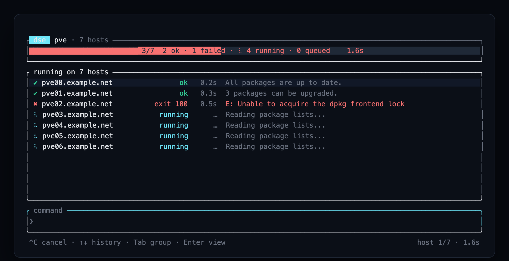
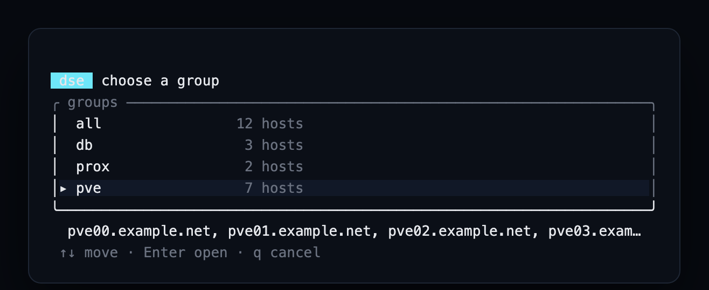
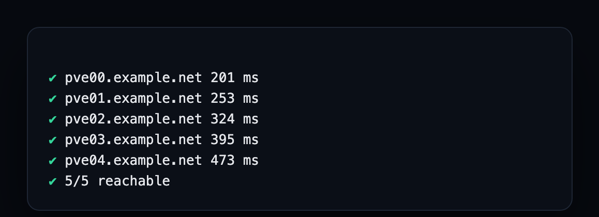
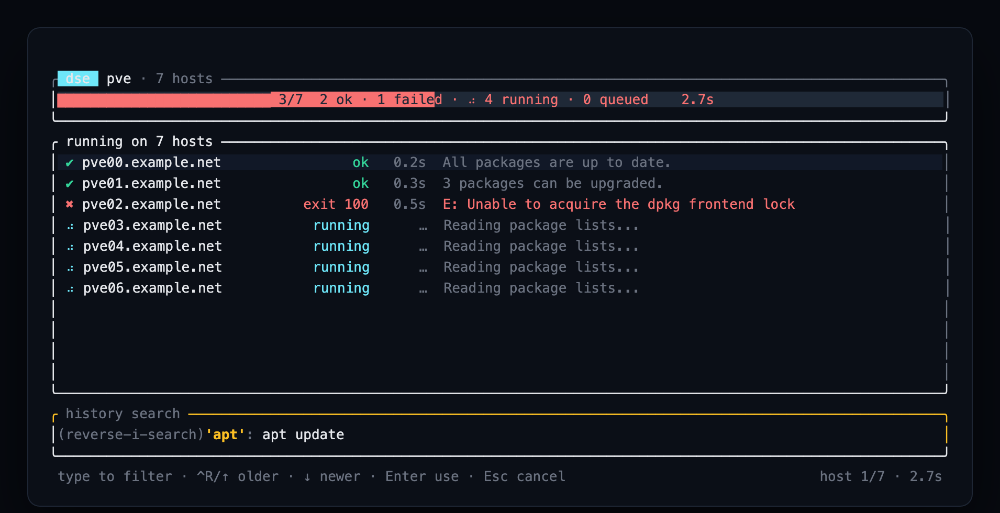

# dse — Distributed Shell Executor

[](https://www.rust-lang.org)
[](LICENSE)
[]()

Pick a group of machines, type a command once, and watch every host report its
own progress, output and exit code — over the SSH config you already have.



`dse` is a terminal multiplexing shell for fleets. It borrows what made `pssh` and
`pdsh` useful — parallel execution, per-host output, an exit-code summary — and
adds a live, modern terminal interface. No inventory, no agents, no server: just
host names and the ssh client you already trust.

## Why

- **No connection settings inside dse.** Hosts are plain OpenSSH targets, so
  `~/.ssh/config`, keys, agent, `ProxyJump`, `Include` and `known_hosts` behave
  exactly as they do in your shell. A group is a list of host names.
- **Async fan-out with a real bound.** Every host runs concurrently under a
  semaphore, streams `stdout` and `stderr` line by line, and is killed when you
  cancel the run.
- **Progress you can read at a glance.** Live gauge and per-host state
  (`queued`, spinner, `ok`, `exit N`, `timeout`, `error`), durations, and the last
  output line; press Enter on a host to read its full output.
- **Terminal-native editing.** Command history with `↑`/`↓` and a zsh-style
  `Ctrl-R` reverse search.

## Install

```sh
cargo install --path .          # binary at ~/.cargo/bin/dse
# or
cargo build --release           # ./target/release/dse
```

Requires Rust 1.88+ and an `ssh` client. The name is **dse** — *Distributed Shell
Executor* — so it does not collide with the classic Debian `dsh` (installed by
Homebrew as `/opt/homebrew/bin/dsh`).

## Quick start

```sh
dse init          # writes a commented ~/.config/dse/config.toml
```

```toml
[defaults]
concurrency = 16              # simultaneous ssh sessions
connect_timeout_secs = 5      # forwarded as -o ConnectTimeout
ssh_options = []              # extra -o options, e.g. ["ServerAliveInterval=15"]
ssh_bin = "ssh"               # client to use

[groups]
pve     = ["pve00.example.net", "pve01.example.net", "pve02.example.net"]
prox    = ["prox00.example.net"]
cluster = ["@pve", "@prox"]   # "@name" nests another group
```

That is the whole setup: no passwords, no keys, no connection modes. Key-based
ssh must already work for those names.

Then open the terminal:

```sh
dse                 # every configured group (Tab cycles between them)
dse -g pve          # one group
```

Type `apt update` (or anything else) and press Enter: it runs on every host of
the selected target while you watch each one finish.

## Commands

```sh
dse                                  # terminal on every configured group
dse -g pve                           # terminal on one group
dse run -g pve apt update            # one-shot run, prefixed streaming output
dse run -H 10.0.0.9,10.0.0.10 uptime # ad-hoc hosts, no config needed
dse ping -g pve                      # can every host be reached over ssh?
dse ping pve00.example.net           # a single machine
dse list                             # groups and their host counts
dse list --long                      # ... and every host of each group
dse pick                             # choose a group from a list, then open it
dse hosts -g pve                     # effective user@host:port resolved via ssh -G
dse init                             # write a starter config.toml
```

`dse run` and `dse ping` exit `0` only when every host succeeded (or answered);
`1` otherwise, so they compose in scripts and CI.

### `dse pick`: choose a group without typing its name



`dse pick` shows every configured group with its host count, previews the hosts
of the highlighted one, and opens the terminal on the group you choose — the
same thing as `dse -g <group>`, without remembering the name. `↑`/`↓` (or `j`/`k`)
move, `Enter` opens, `q`/`Esc` cancels.

For scripts and for a quick look there is `dse list`:

```text
config  ~/.config/dse/config.toml
all          12 hosts
db            3 hosts
prox          2 hosts
pve           7 hosts
```

`dse list --long` prints every host under its group, and `dse groups` still works
as an alias of `dse list`.

### `dse ping`: check a fleet without touching it



A probe is a full ssh session running `true`, so it validates exactly what dse
needs: DNS, TCP, host key, key/agent authentication and the remote shell. The
latency is the whole round trip. `--timeout SECS` (default 10, `0` waits forever)
bounds a dead host: on expiry the ssh child is killed and the host is reported as
a timeout, so one inactive machine cannot stall the report. Nothing changes on
the remote machines.

## Keys

| Key | Action |
| --- | --- |
| `Enter` | run the typed command (with empty input: open the selected host) |
| `↑` `↓` | walk the command history |
| `Ctrl-R` | reverse-search the history, zsh style |
| `Ctrl-P` `Ctrl-N` | select previous/next host |
| `Ctrl-A` `Ctrl-E` | cursor to start/end of the line |
| `Ctrl-U` | clear the line |
| `Tab` | switch target/group |
| `Ctrl-C` | cancel the running command, else clear the line |
| `Esc` | leave the search or the detail view |
| `q` `Ctrl-D` | quit (when the line is empty) |

### Command history



Inside the search: type to filter (case-insensitive substring), `Ctrl-R` or `↑`
for older matches, `↓` or `Ctrl-S` for newer ones, `Enter` puts the match in the
prompt — it never runs it for you — and `Esc` cancels, restoring the line you
were typing. Walking the history with `↑` and back down also restores the
unfinished line. Consecutive repeats are merged (zsh's `HIST_IGNORE_DUPS`), and
the last 50 commands of the session are kept.

## Configuration reference

| Key | Default | Meaning |
| --- | --- | --- |
| `defaults.concurrency` | `16` | maximum simultaneous ssh sessions |
| `defaults.connect_timeout_secs` | `5` | `-o ConnectTimeout` for every invocation |
| `defaults.ssh_options` | `[]` | extra `-o key=value` options |
| `defaults.ssh_bin` | `"ssh"` | ssh client to use |
| `groups.<name>` | — | ordered host list; `@other` nests a group |

The file lives at `$DSE_CONFIG`, else `$XDG_CONFIG_HOME/dse/config.toml`, else
`~/.config/dse/config.toml` (override per run with `--config PATH`). If only the
pre-rename file exists (`$DSH_CONFIG`, `~/.config/dsh/config.toml`), it is used as
a fallback and `dse groups` prints which file was read.

Every ssh invocation is non-interactive on purpose:
`ssh -o BatchMode=yes -o ConnectTimeout=N <host> <command>`. That is why host-key
and password prompts fail fast instead of hanging the UI — keys, agent or
`ssh-agent` forwarding are assumed.

## How it works

| Module | Responsibility |
| --- | --- |
| `src/config.rs` | groups with `@nested` references, de-duplication, safe entry validation, config path resolution |
| `src/ssh.rs` | builds `ssh` invocations, reads `ssh -G` for display only |
| `src/exec.rs` | bounded async fan-out: one task per host, typed events for `stdout`/`stderr`/exit status, per-host timeout, `kill_on_drop` children, aggregated summary |
| `src/app.rs` | UI state machine: prompt editing, history and search, per-host views, cancellation |
| `src/ui.rs` | rendering (gauge, host rows, detail view, prompt) as a pure function of the state |
| `src/tui.rs` | terminal setup, key reader thread, the async event loop |
| `src/cli.rs` | clap surface: `tui`, `run`, `ping`, `groups`, `hosts`, `init` |

## Development

```sh
cargo test                             # 60 tests, no machine required
cargo clippy --all-targets -- -D warnings
cargo fmt --check
```

The suite runs against a shell-script `ssh` stub: it answers `-G`, simulates
success, failure, slow and never-answering hosts, proves the concurrency bound by
measuring peak overlap, and drives "type a command → every host of the group ran
it" through the real engine. `cargo test -- --ignored --nocapture print_preview`
dumps the rendered screen, which is how the screenshots in this README are made:
the app is run in a real terminal, captured with `tmux`, and rendered to an image.

## Roadmap

- Persisted history across sessions (opt-in, `HISTFILE`-style).
- Per-host timeout and retry policies for `dse run` and the TUI (the engine
  already supports it; only `ping` exposes it today).
- ssh multiplexing (`ControlMaster`) or an in-process client to cut connection
  latency on big groups.
- Filters over groups (`tag:proxmox`, ssh-config wildcards) instead of flat lists.
- `sudo` prompts, remote file copy, ordered/rolling execution.

## License

MIT — see [LICENSE](LICENSE).
